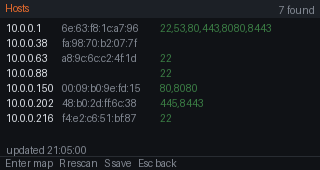
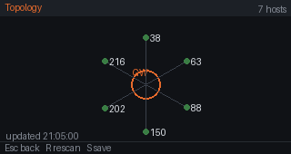

# MapZero

A network topology mapper for the **M5 Cardputer Zero** (Raspberry Pi CM0, arm64
Linux). It scans the network the device is attached to with **nmap**, draws the
discovered hosts and their open services as a topology on the 320x170 screen, and
saves every scan as JSON so it can be reopened later.




## What it does

- **Scan network** - discovers hosts on the local `/24` and the services they
  expose. The scan runs in a background thread so the UI stays responsive; `Esc`
  cancels it.
- **Hosts** - one row per host: name, address and open ports.
- **Topology** - the gateway in the middle, hosts around it. Networks with more
  than eight hosts are drawn on two rings so the labels stay readable.
- **Saved maps** - scans are stored as JSON in `~/.local/share/mapzero/maps` and
  can be reopened (and deleted) from the app.

## Keys

| Key | Action |
| --- | --- |
| `Up` / `Down` (or `Z` / `X`) | move |
| `Enter` | select / open the topology view |
| `R` | rescan the network in the background and refresh the view |
| `S` | save the current map |
| `D` | delete the selected saved map |
| `Esc` | back / quit (during a scan: stop the scan) |

`Esc` during a scan really stops it - the running nmap process is terminated,
not just hidden.

## Install on the device

The app is a plain Debian package that registers itself with the APPLaunch
launcher.

```bash
# on the Cardputer Zero
sudo apt install nmap            # the scanner itself
sudo bash install.sh             # builds and installs the .deb
systemctl restart APPLaunch.service
```

`MapZero` then appears in the launcher carousel with its icon.

To install by hand:

```bash
bash build-deb.sh
sudo apt install ./build/mapzero_1.0.0_all.deb
```

The `.deb` pulls in `python3`, `python3-pil` and `nmap`. `postinst` adds the
desktop user to the `video` and `input` groups so the app can open `/dev/fb0`
and read the matrix keyboard; restart the session (or `APPLaunch.service`) for
the group change to take effect.

## Configuration

Optional, `~/.config/mapzero/config.json`:

```json
{
  "subnet": "192.168.1.0/24",
  "thorough": false,
  "refresh": 0
}
```

`subnet` overrides the automatically detected network. `thorough` makes nmap
scan the top 100 ports instead of a short list of common ones - slower, but it
finds more services. `refresh` is the auto-refresh interval in seconds; `0`
(disabled) means the topology only changes when you press `R`.

## How the scan works

Discovery uses an **unprivileged TCP connect scan** (`nmap -sT`), so no root is
needed:

```
nmap -sT -n --max-retries 0 --host-timeout 30s -p 22,23,53,80,443,445,554,8080,8443 -oX - <host> <host> ...
```

The subnet is split into chunks of 64 hosts so the progress display advances
and one slow host cannot stall the whole scan. Each host is passed as its own
argument - nmap cannot parse a comma-separated list, and trying to made it scan
every host on its own. nmap's XML output is parsed into hosts, ports,
services and (from the kernel ARP cache) MAC addresses.

## Layout

```
app/mapzero.py    framebuffer UI, key handling, screens
app/netscan.py    nmap invocation and XML parsing
app/topology.py   topology model, JSON store
packaging/        desktop entry, launcher wrapper, icon
debian/           .deb control and postinst
tests/            unit tests (parsing, topology, UI flow)
```

## Tests

```bash
python3 -m unittest discover -s tests
```

## Legal

Only scan networks you own or are authorised to test.
